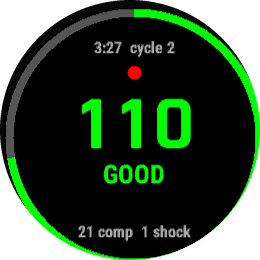
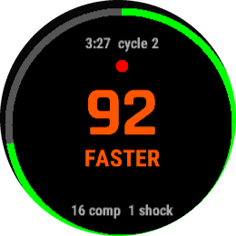
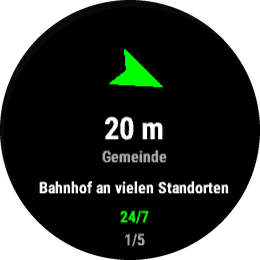
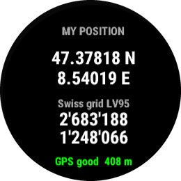
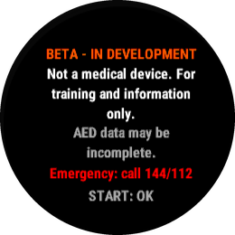

# CPR Coach (Beta)

> [!WARNING]
> **Beta, still in development. Not a medical device.**
> CPR Coach is for CPR training and general information only. It is not intended to diagnose, treat, cure or prevent any disease or condition, and no regulatory agency has reviewed or cleared it. It does not replace a first-aid course, the emergency dispatcher, or the voice prompts of a defibrillator (AED). **In an emergency, always call 144 / 112 first.** The AED locations come from OpenStreetMap and may be incomplete or outdated.

CPR Coach is a Garmin watch app that is a CPR training metronome with live compression feedback and an offline AED finder. It runs entirely on the watch, with no phone and no network.

<p>





</p>

- **Metronome:** vibrates (and beeps) at 110 compressions per minute. It tracks 2‑minute cycles with a warning 10 s before each rescuer swap, and has an optional 30:2 mode with pauses for breaths.
- **Compression feedback:** the wrist accelerometer measures the real rate and shows FASTER / GOOD / SLOWER. When compressions stop it shows PUSH and the hands-off time.
- **Nearest AED, offline:** all 17,628 defibrillators mapped in OpenStreetMap for Switzerland and Liechtenstein are bundled. The screen shows a compass arrow, the distance, where exactly the AED hangs, and whether it's open 24/7.
- **My position:** WGS84 coordinates plus Swiss LV95 coordinates, to read out to 144 or Rega.
- **Summary:** start time, duration, shocks, compressions, average rate and the share of time with hands on the chest.
- **Training mode (manikin):** records raw accelerometer data as a FIT activity and shows an experimental depth estimate.

The disclaimer appears on first launch and is always available under **Options → About**.

## Install

Install it from the Garmin **Connect IQ Store**, either in the Connect IQ app on your phone or in Garmin Express. Search for **CPR Coach**. The app is still waiting for its first store review. The submission material is in [`store/LISTING.md`](store/LISTING.md).

## Supported watches

The app supports 101 round-screen watches (157 device variants) with at least 512 KB of app memory and Connect IQ API level 3.2 or newer:

- fēnix 5 Plus, 6 Pro, 7, 8, 9 and E; epix (Gen 2 and Pro); Enduro 3 and 4
- Forerunner 165, 170, 245 Music, 255, 265, 570, 645 Music, 70, 745, 945, 955, 965 and 970
- Venu, Venu 2, 3, 4 and D; vívoactive 3 Music, 4, 5 and 6
- MARQ (all generations), Descent G2, Mk2 and Mk3, D2 Air and Mach, Approach S50, S70 and S72
- Instinct 3 AMOLED and Instinct Crossover AMOLED

The list comes from the installed device profiles via `tools/select_devices.py`. Rectangular and semi-octagonal screens (Venu Sq, Venu X1, MIP Instinct) are excluded for now.

## Controls

| Screen | START | UP / DOWN | BACK | MENU (hold UP) |
|---|---|---|---|---|
| Start | begin CPR | my position / nearest AED | exit | training mode, 30:2, beep, about |
| CPR | pause / resume | AED / position pages (CPR keeps running) | end CPR (asks first) | log shock, 30:2, beep, end |
| AED | next of the 5 closest | other pages | back to CPR or start | |
| Position | | other pages | back to CPR or start | |

The CPR screen ignores taps on the touchscreen, so clothing brushing against it can't pause the metronome. On touch watches with two buttons, swipe up and down to switch pages.

## Privacy

- There is no account and no network access, and no data leaves the watch.
- Your location is only used on the watch, to find nearby AEDs and show your coordinates.
- Training sessions are saved as a regular activity in your own Garmin Connect account.

## How it works

**Compression detection** (`watch/source/CompressionDetector.mc`). During CPR the arms are locked, so the wrist moves with the sternum, parallel to gravity. The detector works like this:

1. Take the magnitude of the acceleration. That makes it independent of how the watch is oriented.
2. Remove gravity with a slow baseline and smooth out jitter.
3. Count peaks above an adaptive threshold, with a 300 ms refractory period. A parabola fitted through the three samples around each peak gives its exact time between samples. Without that, 25 Hz sampling would snap a 545 ms interval to 520 or 560 ms.
4. Report the rate as the median of the last six intervals.

Depth comes from modelling each compression as a sinusoid (peak-to-peak acceleration = depth × ω²), corrected for the filter gain. It is only shown in training mode until it has been calibrated on a manikin.

**AED data** (`data/build_aeds.py`).

- The script fetches every `emergency=defibrillator` from Overpass.
- Each AED is packed into one 32-bit integer per 0.1° tile, with a "title|where|hours" label.
- The tiles are bin-packed into 236 JSON resources of under 6.5 KB each, about 1.2 MB in total. Small neighbouring tiles share a resource and dense tiles span several. That keeps the app within the 254-resource limit of API 3.x watches.
- `AedFinder` searches rings of tiles outward from your position. It stops once no unscanned tile could hold a closer AED.
- The search runs in small steps so the watchdog never kills it, even in central Zürich (699 AEDs in a single tile).

## Develop

You need:

- JDK 17.
- Connect IQ SDK 9.3, plus the device profiles. Get both through the Garmin SDK Manager.
- A developer key. Generate one with `openssl genrsa ... | openssl pkcs8 -topk8 -outform DER`. `tools/ciq.sh` expects it at `~/.garmin/developer_key.der`.
- `uv`, for the Python scripts.

```bash
tools/ciq.sh build fenix7     # watch/bin/cpr-coach.prg
tools/ciq.sh test fenix7      # unit tests in the simulator
tools/ciq.sh run fenix7x      # launch in the simulator
tools/ciq.sh export           # store package for all supported watches
tools/ciq.sh data             # refresh AEDs from OpenStreetMap, regenerates AedIndex.mc
tools/ciq.sh demo aed venu3   # open one screen with demo state, screenshot to watch/bin/screens/
uv run python -I tools/select_devices.py   # recompute the supported-watch list
```

The demo build (`watch/demo/`, enabled by `demo.jungle`) opens a single screen with realistic state: a GPS fix at Zürich HB, a CPR session already 3 minutes in, and synthetic compressions. That way screenshots need no clicking in the simulator. The available pages are `start`, `disclaimer`, `cpr`, `slow`, `training`, `aed`, `position` and `summary`. Normal builds don't include any of this code.

### Status (2026-10-24)

- **Builds:** all 157 device variants build with no errors.
- **Memory:** the peak is about 93 KB, on the AED screen.
- **Unit tests:** 17/17 pass in the simulator on both a new-firmware watch (fēnix 7, API 5.2) and an old one (vívoactive 4S, API 3.3). They cover:
  - Compression rate at 80, 110 and 140/min, including with noise and a tilted watch.
  - Pauses and resumption.
  - Depth estimate on a synthetic signal: 5 cm reads 4.98 cm.
  - LV95 conversion against swisstopo's worked example.
  - AED search against the real data.
- **Simulator:** the screens have been checked at 218, 240, 260, 280 and 454 px.
- **Not yet tested on a real watch.** Still to confirm: accelerometer behaviour during real compressions, whether the system tolerates a vibration on every beat, compass heading, and GPS time to first fix.

## Next steps

1. **Validate on a real watch and a manikin.** Record training sessions. Ideally use a feedback manikin (for example a Laerdal QCPR) as ground truth. Then fit the depth model offline from the FIT accelerometer data.
2. **Translations:** German, French and Italian.
3. **AED opening hours:** parse `opening_hours` to show "open now".
4. **AED data quality:** prefer recently checked entries (`check_date`), and add a way to report missing or wrong AEDs.
5. **Expert review:** ask the Swiss Resuscitation Council or first-responder organisations about wording and the 30:2 default.

## License

The code is under the MIT license (see [LICENSE](LICENSE)). The AED locations are © OpenStreetMap contributors, under the [ODbL](https://opendatacommons.org/licenses/odbl/).
